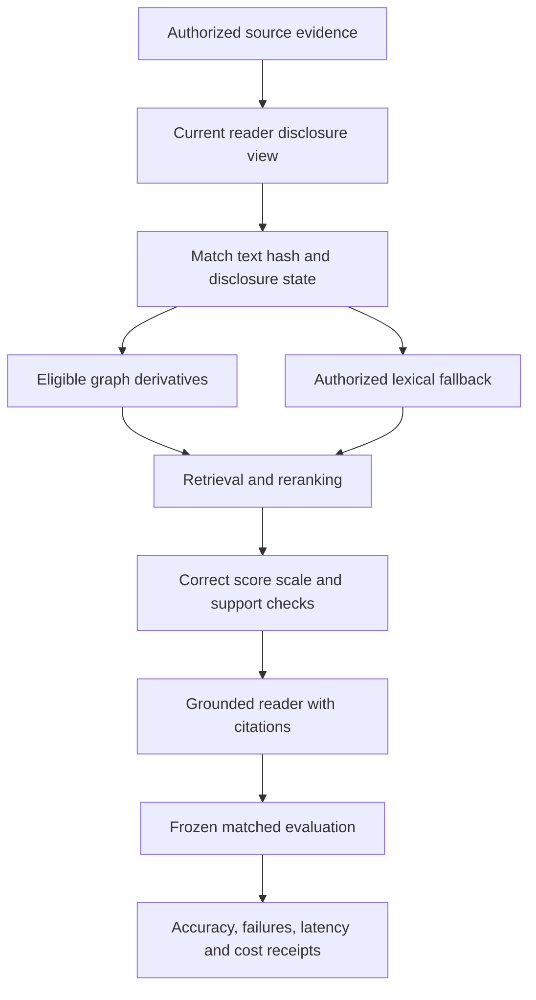

# Memory capability and correctness audit — 22 October 2026

## Outcome and scope

This pass compares public Hindsight behavior with Mnemosyne, audits the score displayed by
Mnemetric, repairs demonstrated correctness/privacy issues, and adds grounded reflection
and private maintained answers.
The later PostgreSQL follow-up also validates publication and worker behavior against
a disposable live database; its results and limits are recorded below.
It does not establish feature parity, a competitive ranking, or elimination of all defects. No Hindsight code was
copied and no external service was penetration-tested.

Work began from Mnemosyne `00d8ea9f7389d3a423d233e5fc0ab959ead8e520` on
`codex/hindsight-memory-audit`. The explicitly authorized local case is recorded in
`work/hindsight-comparison/scope.md`. The reverse-skill router selected code audit after its
initial generic fallback was narrowed to the actual source-review task. Report flavor: none.

- [19-feature Hindsight comparison and delivery plan](HINDSIGHT-COMPARISON.md)
- [Mnemetric score and provenance audit](hindsight-ranking-audit.md)
- [Live PostgreSQL validation and receipts](../work/hindsight-comparison/postgres-live/REPORT.md)
- [Controlled comparison protocol](comparison-protocol.md) — no completed comparative result claimed here

## What the score actually means

The historical pinned Mnemetric JSONL contained 500 question records and
462 correct answers (92.4%). The development subset is 96/100; the held-out subset is
366/400 (91.5%). All 500 recorded reader completions have finish reason `stop`.

Of 38 incorrect answers, 14 lack complete gold-session retrieval and 24 have complete
retrieval. The evidence README divides the latter into 23 reader failures and one abstention
failure. Aggregate multi-session performance is 113/133, the weakest reported category.
Only aggregate outcomes were analyzed here; held-out question text was not used to write fixes
or tune retrieval. The development example returned while inspecting the record schema was
not added to runtime memory or tests.

The chart's Hindsight value is 94.6%, a 2.2-point numerical gap, but differing models and
conditions prevent a controlled comparison. Mnemetric explicitly marks this view as not a
ranking. A better score requires fresh predictions and evaluation receipts, not changing the
chart or reusing development accuracy as a headline.

## Threat model and evidence chain

Assets: source confidentiality, correct time filtering, trustworthy retrieval confidence and
preservation of original stores during evaluation. Inputs: user query strings, changing
reader disclosure state, model-produced rankings and configured external passage indexes.
Trust boundaries: authorized text to cached derivatives; model ranking to confidence;
calendar expressions and caller timezones to date filters; changing clocks to cached results;
original databases to disposable evaluation copies; dry-run requests to provider calls.

| Evidence | Observation | Finding and affected path |
| --- | --- | --- |
| E-001 | Four of six disclosure variants failed before the patch; warm/cold redaction and policy tests pass afterward. | F-001 (high): graph cache reused derivatives inconsistent with currently readable text. `PassageGraphIndex._graph` → graph facts → explanations/model prompts. |
| E-002 | Six transformed-score regressions failed before the patch. | F-002 (medium): second-hop/rerank outputs retained a cosine confidence label. `PassageGraphIndex.rank` → retrieval confidence routing. |
| E-003 | Explicit month/year queries selected the latest matching month instead of the specified year. | F-003 (medium): `query_time_window` → passage date filter → wrong-year evidence. |
| E-004 | Oversized day counts raised errors; invalid explicit years were ignored. | F-004 (medium): untrusted date expression → integer/timedelta/datetime conversion → failed or misleading query. |
| E-005 | External-index regression cases failed before isolation; read-only snapshot tests pass afterward. | F-005 (high): evaluator copied the primary store but loaded the environment-selected original passage index. `store_recall.main` → `cli.load_tools`/indexing → original sidecar mutation. |
| E-006 | Main-store fixtures retained live WAL files in a raw copy; hardlink output aliases were accepted. Staged-backup tests now preserve committed data and reject changing snapshots. | F-006 (high): filesystem copying did not establish a consistent SQLite snapshot and output aliases could overwrite source files. `store_recall.main` → copied tenant databases and journals. |
| E-007 | A caller could not supply its calendar timezone; boundary and daylight-saving tests now cover explicit IANA zones. | F-007 (capability gap): local-day interpretation depended on the execution host. Search API/CLI → `query_time_window` → day boundaries. |
| E-008 | Relative-time queries could reuse yesterday's cached result without a store mutation. | F-008 (medium): implicit-clock windows were absent from cache expiry. `_result_cache_key` → stale time-filtered results. |
| E-009 | Dense dry runs could prepare missing embeddings and call a model despite the no-model contract. | F-009 (medium): `--dry-run` → dense embedding cache/preparation → provider call. |
| E-010 | LongMemEval source sessions previously received ingestion-time defaults instead of their recorded conversation dates. | F-010 (medium): date-sensitive benchmark questions → host clock and newly ingested sources → invalid temporal evaluation. |

### Applied repairs

1. **F-001:** Cache identity includes current text hashes and disclosure eligibility. Persisted
   triples and passage vectors must match the readable text hash from the same database row.
   A mismatch falls back to authorized lexical text. Tests cover redaction, sensitivity changes
   and embedding-partition changes with both cold and warm caches.
2. **F-002:** Successful score transformations report `rrf` or `reciprocal_rank`. Original cosine
   remains diagnostic only. Unchanged cosine retrieval preserves its prior confidence path.
3. **F-003:** Month expressions accept explicit years and remove the year from residual topic
   matching. An integration test distinguishes conversations in August of two different years.
4. **F-004:** Unrepresentable day counts and years return no inferred time window instead of
   raising or silently selecting another year. Ordinary retrieval can continue.
5. **F-005:** An environment-selected passage index is staged and backed up from a read-only SQLite
   connection to that private copy into evaluation temporary storage. New indexes are also confined there. Output
   paths cannot overwrite its database, WAL, SHM, journal or hardlink aliases. Copied graph
   handles close before cleanup.
6. **F-006:** Tenant `.db` files and other detected SQLite files are staged with their WAL and
   rollback journals, checked for stable file identity, size and change timestamps, then
   converted into standalone backups. Changing files trigger at most three attempts before
   failure. SQLite opens only the private staging copy, avoiding creation of WAL/SHM files
   beside the original. Non-database assets are retained and output hardlinks to source files
   are rejected. This gives a checked snapshot per database under ordinary filesystem change
   semantics, not a single atomic instant across all databases and assets. Continuously changing
   sources and hot rollback journals requiring writable recovery fail closed.
7. **F-007:** Search accepts optional `query_timezone`; the CLI exposes `--query-timezone` and
   store-recall questions can supply the same field. One shared validator rejects invalid or
   unavailable IANA zones rather than silently changing timezones. Omitting it preserves
   legacy host-local behavior. Conditional Windows `tzdata` is declared and locked, and
   time-window tests are included in Windows CI. Windows execution was not performed here.
8. **F-008:** Relative-calendar queries without an explicit evaluation instant bypass result
   caching. Fixed-clock calls retain caching and separate entries by caller timezone.
9. **F-009:** Dense mode rejects `--dry-run` before opening its embedding cache or preparing
   embeddings. Default and passage dry runs continue to retrieve and build prompts without
   model calls; live dense execution remains available.
10. **F-010:** Both LongMemEval runners use the dataset's conversation dates, question clock
    and explicit UTC interpretation. Invalid or misaligned dates fail before inference. The
    retrieval-only runner excludes abstention questions after assigning the frozen split and
    records those exclusions instead of scoring nonexistent gold evidence.

### Grounded reflection

`MemoryTools.reflect`, the MCP `reflect` tool, and `mneme reflect` reuse the existing grounded
answer orchestrator. The server fixes limits at three hops, four queries per hop, twenty
evidence records, 24,000 evidence characters and a 2,000-character question. Provider factories
are trusted application configuration, never caller-supplied commands; each call receives a
fresh provider. Existing pinned provider identities and the older evaluation-only `answer`
contract remain intact.

Every hop uses the same authorization context. Evidence is reauthorized and replayed around
reader execution; fabricated quotes, invalid citation spans and policy/content drift cause
abstention. Outputs carry exact-source citations and support quotation or the existing bounded
arithmetic/date synthesis operations. Generated answers are not persisted or reinforced as
facts. Tests cover signed-session forgery and cross-tenant denial, two-hop retrieval,
deterministic synthesis, malformed output, CLI forwarding, and unchanged local/SQLite stores.
An independent source review found no blocking issue in these boundaries.

This is not freeform Hindsight reflection: personality, advisory synthesis and automatic
reflection writeback remain absent. A subsequent phase added the separate maintained-answer
lifecycle described below. Exact citation membership does not
prove semantic answer correctness. See [provider setup and limits](reflect.md). A live
production grounded provider was not exercised; the separate Codex benchmark uses a free-text
reader and does not validate this production feature.

### Default source retrieval

The default local fallback could find the correct source and then bury it: its initial
lexical signal did not account for corpus rarity, and later hashing/overlap reranking
discarded the fused order. Ordinary Local/SQLite search now preserves scoped BM25 relevance
when all candidates are genuine raw text sources and the configured adapters are the built-in
hashing/local pair. The corpus is reauthorized and redacted before indexing, and score metadata
explicitly says `bm25`.

Mixed fact/graph/working/prospective hits, customized or real providers, stored vectors,
explicit-confidence sources, deep search and historical queries retain their existing paths. Tests cover rare terms in
long sources beyond the old candidate cutoff, final result survival, tenant/policy/redaction
boundaries, erasure, sequential/parallel agreement and excluded routes. This conservative
change does not solve mixed-memory fusion or add semantic embeddings.

In the earlier repair-pass experiment on the same 95 answerable development questions, default Recall@5 rose from **57.44% to
92.32%**: 48 questions improved, zero regressed and 47 were unchanged. Passage-mode recall
remained 90.91%. The baseline is `local-recall-dev.json`; the final frozen-code receipt
is `local-recall-dev-runtime-final.json` (32.1 seconds). The matched-data comparison and
source-manifest binding are recorded in `runtime-retrieval-comparison.json`. The same gain
was preserved after all custody, identity and historical-query fixes. This measures retrieval
only and does not establish answer accuracy or a Hindsight win.

An additional historical-query regression was reproduced on Local and SQLite engines:
an ISO `as_of` filter was parsed for the retrieval clock but forwarded as a string to the
graph route, which expects a datetime. The pipeline now normalizes that timestamp once and
rejects invalid types before provider dispatch. ISO strings with different UTC offsets and
equivalent Python datetimes produce matching results without modifying the caller's filter.

### Evaluation integrity and Codex

The new development adapter calls the existing authenticated Codex CLI in isolated ephemeral
sessions. Tools, browser, MCP, plugins and host memory/skills are disabled; unexpected tool
events or invalid structured output fail the attempt. Reader and judge receive separate
contexts. A judge must return exactly `yes` or `no` after case/whitespace normalization.
Failures retain their receipts and prevent publication of an aggregate score.

Run manifests bind selected questions, dataset hashes, source/dependency hashes, Python runtime
and configuration. Resume rejects changed or unmanifested runs. Requested model names are
distinguished from resolved identities, which this CLI did not report. Generation token caps
are not enforced by this adapter, and monetary cost is unknown; calls consume Codex account
quota. This is not offline inference. New accuracy summaries use Wilson intervals so a tiny
all-correct sample does not report the misleading zero-width bootstrap interval.

The first five development trials completed with five correct judgments, using requested
`gpt-6-astra` and low reasoning effort through Codex CLI `0.163.0-alpha.11.2`. All five were
single-session-user questions. This smoke result verifies the path and is too small and narrow
to support an accuracy advantage. The original receipt retains its earlier bootstrap interval;
do not interpret that interval as certainty. Reproduction instructions are in the
[LongMemEval-S guide](../eval/longmemeval_s/README.md).

The corpus was downloaded directly from the official upstream dataset, revision
`98d7416c24c778c2fee6e6f3006e7a073259d48f`. The main file SHA-256 is
`d6f21ea9d60a0d56f34a05b609c79c88a451d2ae03597821ea3d5a9678c3a442`;
the oracle SHA-256 is
`821a2034d219ab45846873dd14c14f12cfe7776e73527a483f9dac095d38620c`.
These inputs remain in the ignored `_scratch/` directory, separate from Mnemetric.

The larger Codex development run was deferred when the user prioritized further runtime
repairs. Two partial attempts were stopped for additional source corrections, with explicit
`.aborted.json` records; neither has a valid aggregate score. The five-question smoke is the
only completed answer run at this stage.

## Summary and proposal source custody

The runtime audit reproduced active summaries being written after a summarizer's source
was deleted, corrected or made private during generation. The old materialization path
trusted the evidence objects captured before the provider call. A second case involved an
already-stale child summary whose raw ancestor had become more private before generation.

Consolidation now snapshots immediate and transitive source custody, rejects missing or
cyclic lineage and a child whose controls are weaker than its ancestors before provider
input, and rechecks source content, policy, trust and sensitivity before derived writes.
Provider execution stays outside the engine lock; final validation and materialization use
the existing same-instance lock for Local/SQLite. Ordinary read telemetry does not falsely
invalidate an otherwise unchanged source. This is not a cross-process or Postgres transaction
lock guarantee.

The focused source-custody tests cover deletion, correction, privacy backfill, retagging,
transitive changes, malformed lineage, provider input mutation, concurrent writers,
harmless reads and stable replay. The early combined receipt is
`summary-custody-verification.xml` (396 passed, 109 optional/live-Postgres cases skipped).
The provider proposal ledger now applies the same source snapshots around generation and
replay. New artifacts record standard source evidence references and a source-state
fingerprint. A cached result is rejected when source content, controls or lifecycle change, or when
the cached record itself becomes private, quarantined, expired or incomplete. Legacy caches
with inputs but no verifiable fingerprint are also rejected. Input-free
proposals retain their existing replay behavior. Requests with stale public controls are
rejected before their source text reaches a provider.

Ordinary retrieval and caller-scoped export also require every source of derived prose to
remain readable. The shared gate recognizes summary references, standard source references
and legacy proposal input references. Missing, malformed, cyclic, redacted or unavailable
lineage withholds the complete derived text. This is stricter than a corroborated assertion,
which can remain supported by another independent source.

When deletion trims one source from a multi-source summary or proposal, the retained row is
marked as having incomplete custody. Keeping the unchanged prose readable after discarding
one of its source references would otherwise hide the dependency and reveal erased-source
material. Such retained audit rows are withheld from scoped reads; this is not secure physical
erasure of every stored byte. Deleting the last remaining source purges the derived row.
Freshly regenerated summaries can use currently valid sources.

Custom lexical evidence hits must resolve to current authoritative rows, even when an adapter
omits source metadata. Unknown or deleted IDs are withheld, and returned evidence text is
rebuilt from the authorized row. This deliberately tightens the lexical adapter contract:
externally indexed evidence must first be registered with the engine. Graph adapters accept
relation hits with checked source evidence and withhold non-relation hits. Cache reuse, persistence, legacy
metadata, ordered multi-source deletion and time-only permission expiry are included in
the regression checks. This protects source custody; it does not automatically rewrite historical summaries
when an unrelated later assertion changes the meaning of a still-readable source.

## Entity identity and API isolation

Distinct Unicode names such as `李雷` and `王伟` previously resolved to the same
`unknown-entity` key. Generated Unicode keys now use normalized, case-folded label hashes
under a `unicode:` namespace that legacy ASCII slugs cannot produce. ASCII identity behavior
is unchanged. Local and SQLite tests exercise resolution, registration and export together,
including separate tenants and an existing ambiguous row whose aliases overlap the new names.
Existing ambiguous records are not split or migrated: their original ownership cannot be
reconstructed safely. Explicit caller/provider `entity_key` values remain authoritative,
including keys already stored in queued work; this repair protects newly generated keys.

Local entity registration also retained caller-owned policy lists and returned shallow copies.
Mutating an input or returned `allow_principals` list could grant another user access to a
private entity. Entity input policies, returned rows and exports now detach nested mutable
values, including legacy external IDs and summaries. Audit alias lists no longer share the
entity's list. Immutable shared CID lists retain their existing storage optimization.

The initial 27-case regression suite reproduced 13 failures. The final suite has 29 entity
safety cases; these and related engine, consolidation and shared-value tests passed **137/137**
in 2.03 seconds. Shared entity/export contracts passed **12 tests**, with six live-Postgres
cases skipped. Receipts are `work/hindsight-comparison/entity-identity-before.log`,
`entity-identity-after.{log,xml}` and `entity-shared-contract.{log,xml}`. Targeted Ruff and
`git diff --check` passed. Those historical receipts did not include live PostgreSQL;
the subsequent live follow-up is recorded below.

## Repository and data independence

Mnemosyne and Mnemetric remain separate code and data projects. Public comparison citations
are permitted evidence references, not runtime dependencies. The research miss-analysis
command now requires an explicit `--index` instead of defaulting to a Mnemetric data path.
The separation is documented in the repository and evaluation guides. This audit did not
modify Mnemetric's repository or import its private question data into Mnemosyne.

## Repair-pass reproduction and validation

The receipts in this section precede the maintained-answer implementation. They bind the
earlier repair candidate, not the later source changes. See the subsequent-phase section below
for current feature verification.

From the repository root, using its locked environment:

```bash
bash work/hindsight-comparison/verify-candidate.sh
```

The script records the exact 40 test modules and runs global Ruff and whitespace checks.
**Repair-pass final verification: 1,672 passed, 114 optional/live-Postgres cases skipped, zero failures or
errors**, across 1,786 cases in 18.61 seconds. Coverage includes retrieval integrity/parity,
CLI/MCP parity, authorization, erasure, consolidation, proposal replay, grounded reflection,
cache behavior, SQLite, provider contracts and all newly added runtime regressions.
The receipt is `work/hindsight-comparison/runtime-final-verification.xml`, with console output
in `runtime-final-verification.log`; global Ruff passed in `runtime-final-lint.log`.
`runtime-source-manifest.json` binds 381 source, test and dependency files. None changed during
this verification. The older `candidate-verification.xml` is an intermediate receipt.

Independent read-custody verification also passed 682 cases with 106 skips, including the
edited portability fixtures and all 62 new read-custody regressions. Its receipt is
`derived-read-custody-verification.xml`. Two separate reviewers reproduced the legacy deletion
and stale-adapter bypasses, then confirmed they were closed on Local and SQLite.

The broader exploratory suite was interrupted around 63% after changes continued during
its execution. It is not a completed validation of this candidate. Its four observed failures
were a native SDK mismatch, a missing latency README, an obsolete egress allowlist entry, and
a source-inspection test reading changed CLI lines after import. The final focused suite
covers these paths on that repair candidate.

The macOS native test used process-local
`SDKROOT=/Library/Developer/CommandLineTools/SDKs/MacOSX26.5.sdk` because the host's default
macOS 27 SDK failed to link its Rust probe. No global SDK setting was changed. Two existing
maintenance checks were also repaired: the latency evaluation directory lacked its README,
and the network-egress allowlist still named a removed `urllib.urlopen` call in `frameworks.py`.

Case-local logs, JUnit results and aggregate score verification live in
`work/hindsight-comparison/`. The earlier three-rule offline Semgrep scan inspected 85 Python source
files for shell execution, dynamic evaluation/deserialization and disabled TLS verification;
it reported zero matches. It was not repeated after the later runtime patches. That narrow
result does not imply a clean security audit. Manual
boundary review identified the issues above that those patterns cannot detect.

## Subsequent phase: maintained answers

The first maintained-answer phase introduced `MentalModelService`, seven MCP/Python
operations, and the grouped `mneme mental-model` CLI. A model stores its private question,
exact read scope, current cited answer, corpus fingerprint and version. Creation is pending;
refresh explicitly runs the existing grounded reader. Clean get/list operations validate
sources without inference or embedding calls. See [usage and limits](mental-models.md).

Freshness covers the readable branch corpus rather than only the previous citations, so new
corrections invalidate an old answer. Current source identity, trust, quarantine, permissions,
historical cutoff and citation spans are checked before returning prose. Supported relative
day windows also expire across clock boundaries; continuously moving questions require a
fixed `as_of`. Stale answers are withheld. Failed forced regeneration preserves a previous
answer only when it still passes all current checks.

These are advisory records, excluded from retrieval and scoped exports. They cannot become
self-supporting evidence. Erasure clears affected branch models' saved answers and advances
their versions; branch discard purges them. History stores at most 32 entries of metadata
and hashes, with no previous answer text. Raw administrative backups retain their normal
retention boundary.

Local, SQLite and PostgreSQL stores implement version compare-and-swap. Local uses an
instance lock; SQLite protects final source checks, publication and the final read with one
`BEGIN IMMEDIATE` transaction. Provider work runs outside those guards. PostgreSQL checked
model versions and reread sources at this stage, without binding publication to an atomic
source snapshot. The later background-refresh and live-validation phases below close that gap.

Independent review reproduced and closed publication-time privacy changes, malformed imported
claim/history extensions, fabricated top-level source IDs, imported answers citing sources
after `as_of`, and a clock rollover during saving. Integration testing also found and fixed
the missing schema-registry entry and preserved the previous JSON bytes when no models exist.
Automatic scheduling, delta refresh, wiki pages and freeform synthesis remained future work
at this stage; the next phase added interval scheduling.

Historical final verification for this phase: **1,889 passed, 114 optional/live-PostgreSQL skips, zero
failures/errors** across 2,003 cases in 20.19 seconds. The 44-module command is recorded in
`work/hindsight-comparison/verify-mental-models.sh`; on this Mac it ran with the process-local
SDK setting described above:

```bash
SDKROOT=/Library/Developer/CommandLineTools/SDKs/MacOSX26.5.sdk \
  bash work/hindsight-comparison/verify-mental-models.sh
```

`mental-models-final-verification.xml` and `.log` contain the test receipts;
`mental-models-final-lint.log` records global Ruff success. All 389 files in
`mental-models-source-manifest.json` were unchanged across final verification. The 170 cases
in the three new mental-model test modules passed. Two independent reviewers reran the
privacy, import and clock repros successfully. The preceding failed integration attempt is
retained in `mental-models-integration-before.{log,xml}`. This phase did not rerun the
development answer benchmark and does not establish superiority over Hindsight.

## Subsequent phase: background refresh and PostgreSQL publication

The maintained-answer lifecycle now includes opt-in interval scheduling. `mental_model_schedule`
and `mneme mental-model schedule` persist due times; `mneme mental-model-worker` checks them
using an explicitly supplied owner and read scope. The standalone worker accepts SQLite and
PostgreSQL. A Local JSON engine can share a worker only within the same process and engine
instance; opening it in a separate background process could overwrite concurrent changes.

Each claim uses an expiring token and model version. Retries use persisted, capped exponential
backoff; successful or unchanged results reset failures. An expired worker cannot publish or
clear a successor's lease. Edits, disabling a schedule and deletion fence in-flight work.
Current ready or legitimate no-answer results are checked without constructing a provider.
Provider exceptions, replay failures and malformed replies now carry an internal failure kind,
so they trigger retries rather than becoming permanent cached abstentions. Public grounded
answer serialization still omits these internal details.

Workers revalidate signed identity and write authority before work, again after source
preparation, and immediately before publication and completion. The transaction-time callback
is read-only; audited authorization runs outside the transaction. Review reproduced expired
authority during both initial and final source snapshots, then confirmed zero unauthorized
provider calls or persisted answers after the fixes. No stored schedule is promoted into an
authorization context.

PostgreSQL now pins scoped exports, source getters and model CAS to one READ COMMITTED
transaction. SHARE locks on source, tenant and branch tables cover inserts as well as updates
and deletes, with a five-second lock-acquisition timeout. They block source writers
across tenants. This closed the implementation gap described in the earlier phase.
Its original verification used mocks/contracts; the subsequent live validation below
exercises permissions, lock contention and concurrency against PostgreSQL 16.15.

This is periodic full refresh after a freshness check. No automatic server startup, cron
expression parser, consolidation-triggered job, delta synthesis, wiki generation or freeform
reader was added. That phase did not start/configure a production provider or run a new comparative
answer benchmark. The [maintained-answer guide](mental-models.md) gives exact commands.

Historical final background-refresh verification: **2,029 passed, 114 optional/live-PostgreSQL skips,
zero failures/errors**, across 2,143 cases in 22.47 seconds. The four new test modules add
136 cases; existing parametrized tool coverage also expanded. The 48-module command is
`work/hindsight-comparison/verify-background-refresh.sh`, run with the same process-local
SDK setting above. Receipts are `background-refresh-final-verification.{xml,log}` and
`background-refresh-final-lint.log`. All 395 files in `background-refresh-source-manifest.json`
were unchanged during verification. Global Ruff and whitespace checks passed.

The three-rule offline Semgrep scan was repeated on seven changed runtime files with zero
matches and zero scan errors (`background-refresh-sast.json`). This remains a narrow pattern
scan, supplemented by the independent race and authorization reviews described above.

## Push follow-up: dependency advisory applicability

The push exposed Dependabot alert #6 for `mnemosyne-memory`. Review confirmed a
package-name collision: our lockfile references this local editable project, whereas
[GHSA-xcw4-53cc-hv32](https://github.com/advisories/GHSA-xcw4-53cc-hv32) concerns the separate
`mnemosyne-oss/mnemosyne` sync server. That module and its affected endpoints are absent
here. The existing authentication suite passed **41 tests**, with one optional live-provider
skip; algorithm rejection and signature-tampering checks passed. The alert was dismissed as
inaccurate with supporting evidence, and GitHub's persisted dismissal was verified.
[The case note](../work/hindsight-comparison/evidence/E-dependency-alert-6.md) contains
the source mapping and test receipt. No dependency or package-version change was needed.

## Live PostgreSQL follow-up

The authorized follow-up began at `d59d4e5d3b3736cbf28719b659f766a65ad9559c` and
used a disposable PostgreSQL **16.15** container bound to `127.0.0.1:55432`, with the
repository schema and role policy. Runtime tests used the non-superuser,
non-BYPASSRLS consolidator login. Separate app and readonly logins exercised permission
boundaries; only the isolated schema-upgrade test used an administrator DSN.

The final eight-module PostgreSQL suite passed **235 mixed live/unit tests**, with
**zero skips, failures or errors, in 53.296 seconds**. This total includes mocked
contracts as well as live tests. Its **16 new live tests** cover mental-model source
insertion, deletion and privacy changes during generation/publication, lease takeover
and expiry, transaction rollback, pooled tenant isolation, model ownership, readonly
denial, and actual five-second lock timeout/recovery. The live role check passed
**9/9 checks with no findings**. Provider replies were deterministic fixtures; lease
expiry used a controlled UTC clock with real concurrent PostgreSQL sessions.

The run exposed three integration defects:

- **Model deletion privileges:** the table owner lacked DELETE on `mental_models`,
  preventing authorized app deletion and the branch foreign-key cascade. A narrow
  grant and matching role-check allowlist repair both. Wrong-owner service deletion
  is still rejected, and app DELETE on evidence, branches and audit rows remains denied.
- **Invalid external evidence IDs:** PostgreSQL source revalidation raised on a
  non-hexadecimal adapter identifier. It now treats that identifier as missing before
  database access. The live adapter test also verifies replacement of untrusted preview
  text with the authorized stored text.
- **Provider request source references:** secret filtering replaced valid source CIDs
  in the structural request field, making command consolidation fail its custody check.
  The sanitizer now preserves valid references in that field while retaining secret
  redaction elsewhere; custody validation remains strict.

Two working-memory fixtures were corrected to supply evidence belonging to the stated
user/session. Prospective-memory fixtures retain synthetic tenant/audit rows until the
disposable database is destroyed instead of requiring runtime tenant-purge privileges.
The updated fixtures preserve the runtime's ownership, RLS and audit-retention rules.

Mental-model publication holds SHARE locks on whole source tables inside its final
READ COMMITTED transaction. Competing source writes wait until commit or rollback;
provider work remains outside that transaction. Writers in unrelated tenants can also
wait, so production throughput and high-load contention still need measurement. This
validation does not extend atomic publication guarantees to every consolidation path.
Remote deployments, other PostgreSQL versions and live production grounded-provider
responses were not tested here.

The [validation report](../work/hindsight-comparison/postgres-live/REPORT.md) links the
[JUnit receipt](../work/hindsight-comparison/postgres-live/postgres-final.xml),
[role check](../work/hindsight-comparison/postgres-live/role-check.json), before/after
evidence, environment details and tested source hashes. Ruff and whitespace checks
passed. The owned database container and its tmpfs data were removed; unrelated local
services were preserved, as recorded in the [cleanup receipt](../work/hindsight-comparison/postgres-live/cleanup.json).

The separate [controlled comparison protocol](comparison-protocol.md) defines the
held-out native-ingestion/recall pilot with a common Codex reader and judge, frozen
configuration and per-question failure accounting. No completed comparative result or
ranking claim follows from these PostgreSQL tests.

## Change-aware refresh and evaluation cancellation

The owner stopped the comparison during native Hindsight ingestion and asked for
continued Mnemosyne improvements instead. The runner and its own Codex subprocesses
were stopped, partial receipts preserved, and the disposable Hindsight database
removed. No Hindsight case completed, no common reader/judge phase ran, and no
comparison score was produced. The
[cancellation receipt](../work/hindsight-comparison/controlled/run-v1/hindsight-cancellation.json)
records known partial usage separately from unknown cost. The stopped experiment
is not work to resume without a new request.

The worker now offers opt-in `check_changes=True` in Python and `--check-changes`
in the CLI. One shared authorized-corpus snapshot per eligible poll can identify
stale scheduled answers before the normal interval. Ordinary due work has priority;
the existing batch limit, exact owner/read scope, lease fencing and durable retry
backoff remain in force. Early attempts wait at least 60 seconds after both the
previous start and finish. A failed scan skips early candidates; it does not turn
every model into a provider job.

The shared snapshot is only a scheduling hint. Each claim compares the listed model
version, and refresh still checks current source custody and worker authority before
provider input and final publication. If sources reverted after polling, a fresh
answer can be reused without loading a provider. This is change-aware polling with
full refresh when needed, not incremental synthesis or a consolidation-event queue.

The bounded evaluation-code review also repaired concurrent runner admission and
interruption handling. OS-held locks prevent a second process from misclassifying
active claims as crashed. Cancellation stops queued work, checks again after prompt
preparation, and preserves admitted calls' receipts inside their workers. The
[review and test record](../work/hindsight-comparison/controlled/runner-recovery-lock-review.md)
documents those fixes without running another benchmark.

Final expanded local regression: **2,192 passed, 114 optional skips, zero
failures/errors**, across 2,306 cases in 27.614 seconds. The command is
`work/hindsight-comparison/verify-change-refresh.sh`; its
[JUnit receipt](../work/hindsight-comparison/change-refresh-final-verification.xml)
and lint log record the result. The change-aware worker adds 52 focused Local/SQLite
cases. Independent review covered those and the 65 existing worker cases. The
separate live PostgreSQL results are linked from its validation report.

The final PostgreSQL follow-up passed **239 mixed live/unit tests**, zero skips,
failures or errors, in **59.271 seconds**, and repeated the **9/9** role checks.
Four additional live tests exercised early change-triggered refresh, unchanged
provider-free checks, retry backoff and a competing version update. Together
with the original 16 new live cases, this pass adds 20 live tests. The
[follow-up receipts](../work/hindsight-comparison/postgres-live/change-refresh/REPORT.md)
preserve the earlier 235-test result as historical evidence.

## Subsequent evidence reliability repairs

The [reliability follow-up](../work/hindsight-comparison/reliability-followup/REPORT.md)
records the next source-review pass and its verification receipts. It repairs
rejected ingestion being treated as creation, failed local writes remaining
visible in memory, mutable metadata aliases, PostgreSQL metadata/privacy
lost updates, trust-tier priority settings changing on JSON reload, and temporal
speaker/DST/ordering errors. The PostgreSQL races were reproduced with real
concurrent sessions; local disk failures were injected at fsync and rename.
The expanded restricted-role suite also exposed entity erasure failing on its
alias cascade. A narrow derived-table grant fixes that failure while preserving
app restrictions on source and audit deletion.
Final combined verification passed **1,422 tests**, with six intentionally
inapplicable backend cases skipped and no failures/errors; 323 source/test/config
hashes stayed unchanged. The role check passed 9/9 and the disposable database
was removed without changing the existing local services.

The owner stopped benchmark work before this pass. Verification uses synthetic
regression fixtures without model inference. First-class growing-document
versions and atomic retirement remain open; content-addressed source labels
must not be treated as independently deletable documents.

## Quality targets still unmet

The local deterministic quick evaluation passed **8 of 11** checks and all five mandatory
behavior classes. It did **not** meet calibration error (0.2104 against a maximum of 0.05),
answer-quality lift (-0.3333 against a minimum of 0.15), or token-efficiency answer parity
(0.6667 against a minimum of 0.95). These results remain visible in
`work/hindsight-comparison/local-eval-final/slo_report_latest.json`.

This 25-case quick run remains in SHADOW mode below its 40-case activation threshold. Its
answer test uses a deterministic substring judge; full context already scores 1.0, making
positive lift impossible in that proxy. It is useful for finding retrieval and budget losses,
not for establishing production answer accuracy. The receipt predates the final custody
repairs and is not a release certification. The failed targets were not relaxed.

## Remaining work

- Live PostgreSQL 16.15 publication and permission checks now pass as described above.
  Windows execution, live production grounded-provider responses, other database versions
  and long-running production concurrency remain untested here. Targeted passes are not
  whole-repository or production certification.
- Incremental/delta mental-model refresh, knowledge pages, contextual entity resolution,
  complete evolving observations and freeform reflection remain roadmap work. Existing Mnemosyne components must be
  reused rather than duplicated without behavioral tests.
- The [controlled quality protocol](comparison-protocol.md) records frozen held-out selection,
  identical reader/judge settings, pinned ingestion/retrieval configurations, budgets and
  per-question receipts. Execution was cancelled at the owner's request; no comparative
  result is claimed and no continuation is scheduled.
  The archived score is an in-process dense-retrieval experiment, not a measurement of every
  default product configuration.
- Earlier evaluation used the existing Codex account. Its inputs, configuration,
  historical predictions and receipts remain in Mnemosyne's evaluation area. Development results
  must not be presented as a matched Hindsight comparison without matching conditions.

## Data flow and proposed evaluation loop



The grounded-reader boundary is implemented and tested. The matched evaluation was
cancelled; the separate Codex development runner and PostgreSQL validation do not
establish that comparison.
