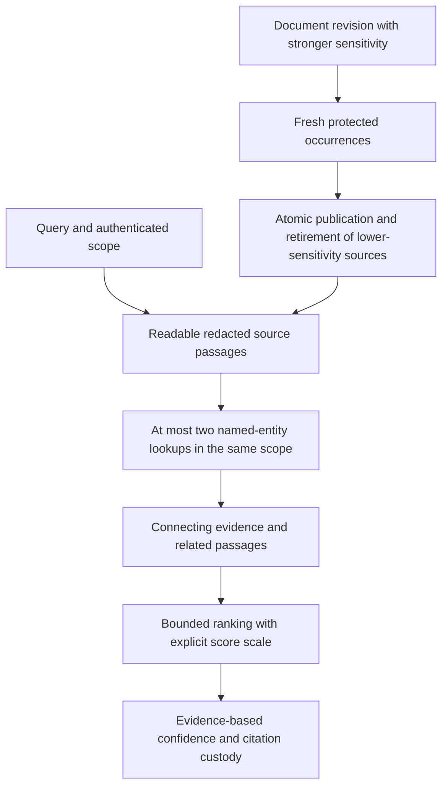

# Retrieval and document privacy hardening

Date: 2026-10-26. Baseline: `fe1f8695`. This follow-up reviewed existing uncommitted
retrieval work before editing. It ran no full benchmark and no model inference.

## Reproduced findings and repairs

1. A relational source search raised `NameError` in a process-argument guard.
   Bounded entity expansion now operates independently of evaluation flags and
   source labels, returns connecting evidence, and labels interleaved scores.
2. Source event metadata could repeat text hidden by a read redaction. Shared
   Local/PostgreSQL projection now validates dates and omits them on redacted reads.
   Candidate creation times serialize as strings rather than raw datetime objects.
3. Reordering unchanged chunks could form PII, raise document sensitivity, yet
   leave reused sources readable at their old lower sensitivity. Such occurrences
   now receive fresh protected sources; retirement and publication are atomic.
4. Matching words forced near-certain confidence even with weak low-trust evidence.
   Both engines now retain evidence-based confidence without that floor.
5. A pending dev test compared against an all-partitions baseline and dropped
   reproducibility checks. Matching floors, exact fresh coverage, repeat-run
   comparisons and fail-closed numeric checks are restored. Saturation is diagnostic.
6. Freshness scoring could replace requested-speaker ordering. Speaker and explicit
   temporal order now take precedence; freshness only breaks relevance ties.

## Verification

- `native.xml`: **268 passed, 1 skipped** across source/document transactions,
  native Local/SQLite/PostgreSQL paths and actual bridge/metadata checks. The one
  skipped app-role test was subsequently run successfully in `roles.xml`.
- `retrieval.xml`: **416 passed, 1 skipped, 1 deselected**. The live PostgreSQL
  bridge test was subsequently strengthened and passed in `roles.xml`; the
  deselected poison-corpus harness was intentionally not executed.
- `roles.xml`: **46 passed, 1 deselected**, including the PostgreSQL app role,
  actual cross-tenant bridge lookup, interleaving boundaries and adversarial units.
- Suites overlap; these counts must not be added as unique tests. Additional
  focused temporal/parser tests and pre-fix document reproductions were checked
  during implementation. Ruff and whitespace checks passed.
- The disposable PostgreSQL instance used loopback port 55434, with restricted
  application/consolidation roles. Unrelated services were not changed.
- `source-sha256.json` identifies source/test contents. `verification.json` and
  the XML files retain test receipts. Existing evaluation JSONs were not promoted
  to fresh performance evidence.

## Limits and next work

No superiority claim over Hindsight is established. The full quality benchmark
was not run. Confidence remains heuristic. Bridge lookup is bounded and restricted
to the source-only route. No migration repairs already-inconsistent persisted
source sensitivity automatically; affected documents need republishing. A
separate user-requested whole-book/chapter framework improvement is now underway.
