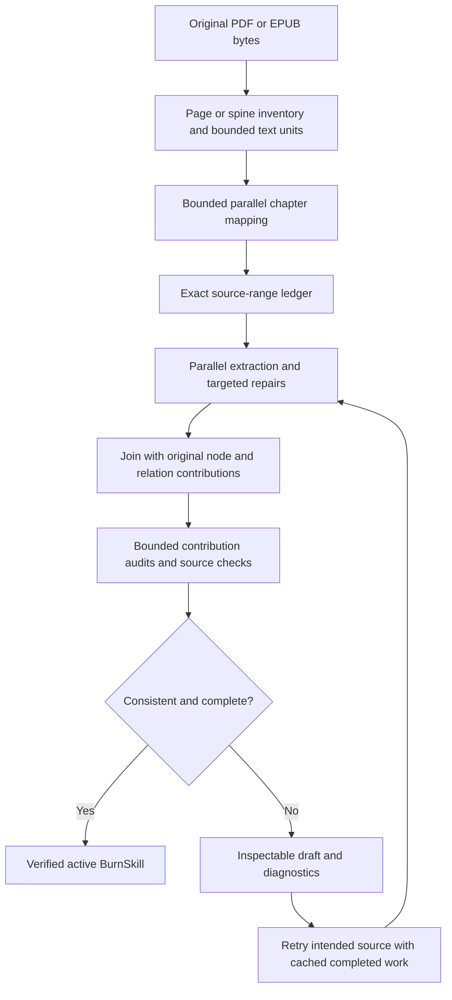

# Whole-book integrity — 2026-10-26

Mnemosyne now retains inspectable source/chapter accounting and complete original
node and relationship contributions through bounded book conversion. Incomplete
or inconsistent results remain drafts. This is implementation and regression
evidence, not a benchmark or evidence of superiority over another memory system.

Baseline: `b63b34616f65e31457f3bc243b158d479f734e68`.
The exact tested source and test bytes are in [source-sha256.json](source-sha256.json).

## Delivered behavior

- Preserve the original PDF/EPUB bytes; validate spine items and archive targets,
  retain source/page inventory and publisher TOC resolution details. Record truly
  blank PDF pages; reject unreadable nonblank pages. Long text is split into bounded
  source units without dropping words or merging EPUB spine items.
- Map every imported book, including short books. Process independent windows and
  chapter parts with at most three workers. Explicit ranges, gaps, overlap, failed
  parts, reference classifications, and exact-text duplicates remain accountable.
- Preserve each chapter's node fields, quotations, citations and relationship
  explanations when joining shared concepts. Unicode names retain their identity.
  Full contribution views and rationale views allow large merged concepts to be
  audited in bounded batches, with explicit endpoint and coverage records.
- Ground every substantive node's quotation and core sentence in its cited source.
  Invalid quotations receive targeted repair; unresolved findings block approval.
  Completed request caching is atomic and reusable across retry attempts.
- Recompute structural, coverage, quotation and document consistency checks on
  import/activation. Supplied success flags cannot bypass these checks. Changes
  needed by validation cannot approve an unrepaired original. Drafts retain the
  prior active revision and retry the latest intended source.
- CLI `--wait` keeps conversions alive, reports progress, and exits nonzero for
  incomplete/failed work. Direct Q&A no longer silently slices each input at
  40,000 characters; an oversized provider request fails explicitly.



## Verification

| Receipt | Result | Scope |
| --- | --- | --- |
| [book.xml](book.xml), [book.log](book.log) | 171 passed; no failures or skips | Existing skill/framework tests plus book input, chapter, contribution, quote, import, CLI wait and Q&A regressions |
| [cli.xml](cli.xml), [cli.log](cli.log) | 664 passed; no failures or skips | CLI wait, public CLI/MCP parity and runtime tools |

There are **823 distinct test cases** across these overlapping suites; counts
must not be added as though disjoint. The book suite uses deterministic model
doubles, isolated stores and synthetic fixtures. The retained long-book test has
400 paragraphs / 48,000 words; separate tests check chapter ranges. It is not a
400-chapter real-book evaluation. The synthetic PDF test used the existing
bundled `pypdf 6.10.0`, with no package installation.

Book suite reproduction in this workspace:

```sh
.venv/bin/python - <<'PY'
import sys, pytest
sys.path.append('/Users/admin/.cache/codex-runtimes/codex-primary-runtime/dependencies/python/lib/python3.12/site-packages')
raise SystemExit(pytest.main([
    'tests/test_skill_frameworks.py',
    'tests/test_book_framework_integrity.py',
    'tests/test_book_import_integrity.py',
    'tests/test_book_cli_wait.py',
    'tests/test_book_ask_integrity.py',
    '--tb=short', '--junitxml=/tmp/mnemosyne-book-final-validation.xml',
]))
PY
```

The extra path supplies only already-installed dependencies missing from `.venv`.
On another installation, use its normal environment with the book PDF dependency.

CLI regression command:

```sh
.venv/bin/python -m pytest tests/test_book_cli_wait.py tests/test_cli_mcp_parity.py tests/test_cli_runtime_tools.py --tb=short --junitxml=/tmp/mnemosyne-book-cli-final.xml
```

Ruff and `git diff --check` passed. Independent review findings were fixed and
the final affected suite rerun. GSD continuation criteria and review are retained
under `.planning/quick/2026-10-26-whole-book-integrity/`.

## Limits

No full benchmark, Hindsight comparison run, or provider inference ran. Model
extraction quality and real-model speed remain unmeasured. These changes do not
establish first-place ranking or guarantee every idea in a book is understood.

Import is text-only: no OCR, figure interpretation, or PDF outline extraction.
Publisher TOC and inferred chapter ranges remain separately inspectable. Source
accounting does not establish semantic completeness. Bounded audits record every
original contribution they reviewed, but do not compare every possible variant
pair or unrelated statement pair. Indivisible oversized evidence groups remain
incomplete rather than being truncated. Existing stored artifacts are rechecked
at import/activation; this change does not automatically migrate all old stores.

Historical benchmark and hardware acceptance gates remain unchanged. Mnemosyne
and Mnemetric remain independent code/data projects.
